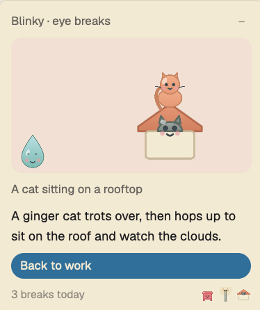

# Blinky: eye breaks for Herdr

Blinky is a small water-drop buddy for the [Herdr](https://herdr.dev) desktop app that reminds you to rest your eyes with the 20-20-20 rule: every 20 minutes, look at something about 20 feet (6 metres) away for 20 seconds, and blink slowly.

After each break, Blinky asks what you saw far away and turns your answer into a tiny drawn story. Say "a cat on a roof": Blinky sketches the cat on the roof, then a ginger cat trots over and hops up beside it.

## Install

1. Copy the `mods/blink-buddy` folder into `~/.config/herdr-app/mods/`.
2. In Herdr, open the command palette and choose **Blinky: eye break buddy**.

Blinky opens as a small floating window. Drag it wherever you like, and fold it with the `–` button. When a break comes due while it is folded, it unfolds in the middle of the window, then folds back after the break.

You can also ask a coding agent running in Herdr to install it from this repository. Herdr's own instructions (`~/.config/herdr-app/AGENTS.md`) tell it how.

## What it needs

- **Herdr** on macOS. Idle detection (`ioreg`) and the system notification (`osascript`) are macOS only. On other systems the breaks still work, without those two extras.
- **Optional: [Claude Code](https://claude.com/claude-code)**, installed and logged in, for the drawn stories. Blinky looks for `claude` in `~/.local/bin`, then on your `PATH`. Without it, Blinky's own star friend appears with a short line about what you saw.

## Privacy and cost

- When you answer "what did you see?", Blinky sends **only that answer** to Claude Haiku through your Claude Code command line. It runs with no tools, no MCP servers and no saved session.
- Each break makes two small requests. In testing they cost about 1 US cent together on API billing; on a Claude subscription they count toward your usage.
- To keep everything on your computer, set `USE_LLM = false` near the top of `mods/blink-buddy/main.js`.
- Every drawing Claude returns goes through a strict check before Blinky shows it: only plain shapes, and nothing with links, scripts, styles, images or entities. A drawing that fails the check is dropped. Drawings are kept in `~/.config/herdr-app/blinky-scenes/` and deleted after two days.

## Settings

The timings are constants at the top of `main.js`: `WORK_MS` (20 minutes between breaks), `BREAK_MS` (20 seconds), `SNOOZE_MS` (5 minutes) and `IDLE_RESET_S` (5 minutes away from the computer counts as a rest and restarts the timer).

Blinky is a friendly reminder, not medical advice. If your eyes hurt or feel dry often, see an eye doctor.

## License

MIT. See [LICENSE](LICENSE).
