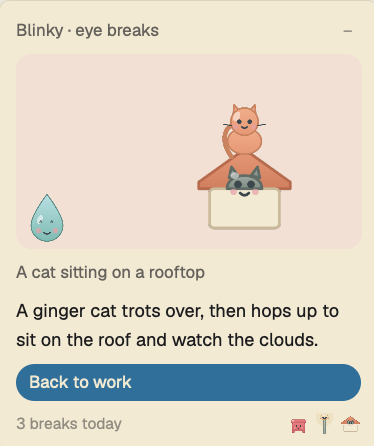

# Blinky

A floating water-drop buddy that reminds you to take 20-20-20 eye breaks. Every 20 minutes it asks you to look at something about 6 metres away for 20 seconds and blink slowly. Afterwards it asks what you saw, and Claude Haiku turns the answer into a tiny three-beat story drawn in Blinky's own style.

## What you see

- **A floating window, 290 px wide**, with the header "Blinky · eye breaks" in muted 13 px text and a `–` button that folds it. Folded, it is one row: a 30 px Blinky, the minutes left (or "Break time!" or "Paused"), and a `▢` button to unfold.
- **Blinky** is `drop.svg`: a droplet with an aqua gradient (`#b9e0e3` to `#7fbbb3`), a `#5d8f88` outline, a white highlight, pink cheeks (`#e8a0a8`) and a smile. Its eyes are text over the picture: `●` most of the time, blinking to `‒`, `^` when excited, `‒` while resting.
- **Work:** Blinky, "Blink blink!", "Next eye break in N min", a thin progress bar in the accent colour, and the buttons Break now and Pause.
- **Due:** a bobbing, excited Blinky, "Eye break time!", and the buttons Start break (primary) and "In 5 min".
- **Break:** a resting Blinky, a large countdown from 20 in the accent colour, "Look at something about 6 metres away…", "and blink slowly, all the way closed.", and Skip.
- **Ask:** "Well done! What did you see far away?", a text field with an accent border, and Tell Blinky (primary) and Skip.
- **Story:** a 266 × 150 rounded stage, with a small Blinky in the bottom-left corner. Below it are two captions (13 px muted, then 14 px semibold) and Back to work.
- **Footer:** "N breaks today", and the last six drawings as 16 px stickers.

## How it behaves

- **Timing.** Every 20 minutes the break comes due, with a Herdr toast and a macOS notification. The break lasts 20 seconds. "In 5 min" snoozes the break. Being idle for 5 minutes or more (from `ioreg` HIDIdleTime, checked every minute) restarts the 20 minutes and shows "Welcome back!".
- **Centring.** If Blinky is folded when a break comes due, it unfolds and reopens as a centred window: key `blink-buddy-break`, props `{role: "break"}`, centred using `window.json` bounds and the zoom. Back at work, that window folds Blinky and reopens the normal window (key `blink-buddy`) at its remembered spot (`windows.json` → `places`). Herdr cannot move a window, so each swap opens the other window and closes this one. Only one is open at a time.
- **The story after you answer:**
  1. At once, a pencil (`pencil.svg`) scribbles in the middle of the stage, with "Blinky is drawing it…".
  2. Two `claude -p` requests start together, both Haiku at low effort with no tools, no MCP servers and no saved session.
  3. The quick request draws only the thing you saw: a caption line, then one SVG. Its `stream-json` output goes to a file that is read every 200 ms. The caption shows as soon as it arrives. Each finished shape becomes a new frame, saved after closing the open tags and passing the safety check. The newest two frames are stacked so nothing blinks. The picture counts as finished as soon as `</svg>` arrives.
  4. The slower request returns JSON with `caption2`, a background mood, where the thing goes in beats 2 and 3, and 1 to 3 new characters. Each character has its own SVG, a size, spots in beats 2 and 3, an entry side, an idle motion and an optional `on_top_of`.
  5. Thinking dots show until the story is ready. Beat 2 starts once the picture has been alone for 2.8 seconds and the characters have waited off stage for 0.6 seconds. The characters walk in, and the thing moves or shrinks. Beat 3 follows 2.8 seconds later.
  6. Blinky returns to work 25 seconds after that.
- **Something worn or perched** in beat 3 is seated on top of its target. This happens when `on_top_of` names the target, or when a smaller actor ends up just above another one. It is drawn in front, moves with its target, and shrinks to 60% of the target's size if it is bigger than 70% of it.
- **Fallbacks.** If the picture fails, `star.svg` (a star friend) stands in for it. If the story fails, or its caption looks lazy, a keyword line from the `SCENES` list shows instead. If `USE_LLM` is `false`, nothing is sent at all.

## Built from

- One mod, `mods/blink-buddy`: `main.js`, a `mod.json` with `place: "none"`, a kept window overlay with key `blink-buddy`, and a palette entry using `mod.open`, plus `drop.svg`, `star.svg` and `pencil.svg`.
- **State** lives in `shared("blinky.state")`, so both windows see it. It holds the phase, the due time, the count, the views and the folded flag.
- **From herdr:** `theme`, `settings`, `notify`, `exec`, `checking`, `home`, `appHome`, `props`, `shared`, `setShared`, `openOverlay`, `closeOverlay`, `readTextFile` and `fs/promises`.
- **Animation is native only:** `.frames` for the eyes and dots, `.loop` for the bobbing, the pencil and the idle motions, and `.transition` on left, top, width and height for walks and size changes.
- **Programs:** `ioreg` and `osascript` (macOS), and `claude` (`~/.local/bin/claude`, otherwise from `PATH`).
- **Drawings** are saved under `~/.config/herdr-app/blinky-scenes/`, outside `mods/`, so writing them never hot-reloads the mod. They are deleted after two days.

## Watch out

- Every SVG from the model is untrusted. It must start with `<svg` and end with `</svg>`, and be at most 4,000 characters. Tags must be on an allowlist (svg, g, path, circle, ellipse, rect, line, polyline, polygon, defs, linearGradient, radialGradient, stop). Nothing with `href`, `style`, `on…=`, `&`, `<!`, `<?`, `data:` or `javascript:` is allowed, and `url()` may only be `url(#id)`.
- Haiku plans silently for several seconds before writing, and settings do not stop it. That is why the plain picture is its own small request, and why something local (the pencil) has to appear first.
- Haiku sometimes writes a sentence before the caption line. The caption is taken from the last line before `<svg`, cut at ", drawn" or ": ".
- Never save files under `mods/` while a story plays: that reloads the mod and ends the story.
- Run `claude` with stdin closed (`< /dev/null`) and the answer as an argument, or it waits for input.
- In a stack header, Herdr wants `{"content": "tabs"}`, not `"tabs"`. This matters only if you put Blinky in a layout.

## Done when

- `herdr-app check mods/blink-buddy` passes.
- Break now shows a 20-second countdown, then the question.
- Answering shows the pencil within a second. A caption and a shape-by-shape picture follow within about 3 to 8 seconds, and two story beats with new characters follow within about 20 seconds.
- Answering "a knight helmet" ends with the helmet, shrunk, on the knight's head.
- With `claude` missing, the star friend and a keyword line appear.
- Folding Blinky and pressing Break now opens one centred window; Back to work folds it again at the old spot, still as one window.
